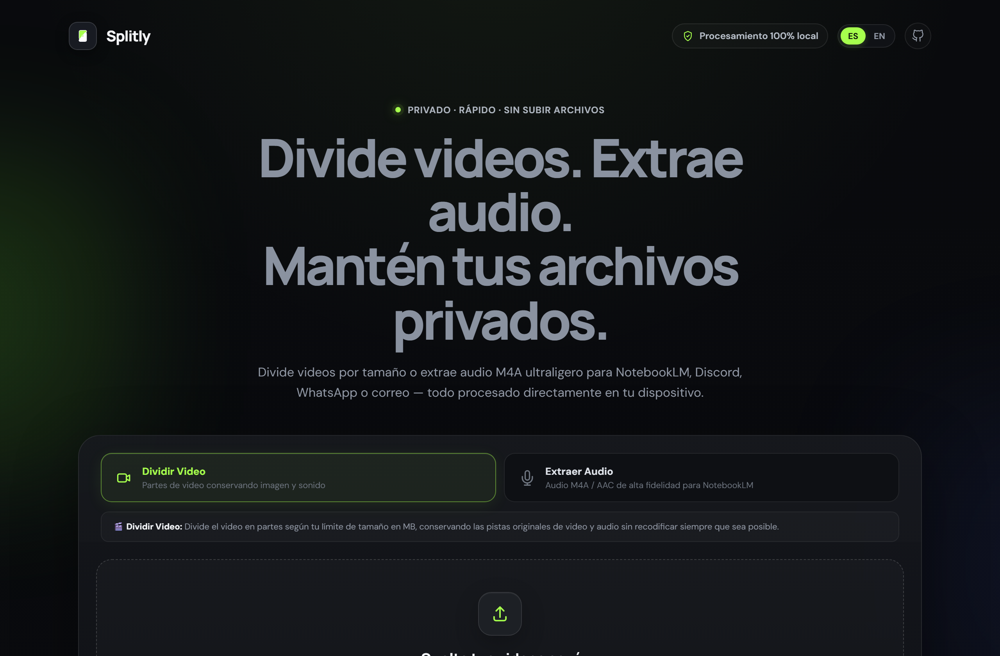
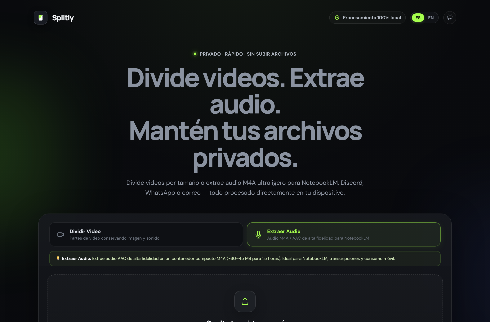
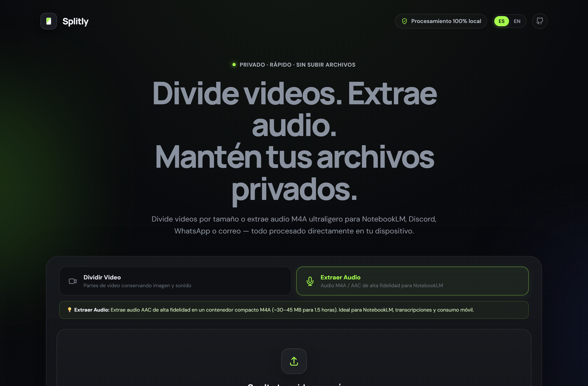
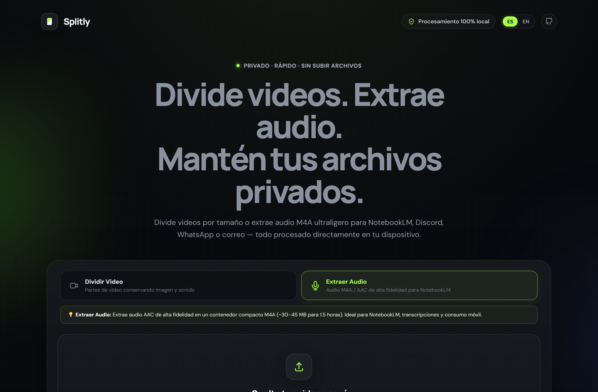
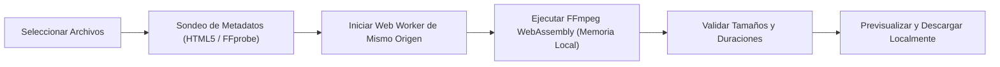

<div align="center">


<p><strong>Divide videos. Extrae audio. Mantén tus archivos privados.</strong></p>

<p>
  <a href="README.md">English</a> | <strong>Español</strong>
</p>

[](LICENSE)
[](https://github.com/santi-osp/DividirVideosNotebookLM/actions/workflows/ci.yml)
[](https://santi-osp.github.io/DividirVideosNotebookLM/)
[](https://github.com/ffmpegwasm/ffmpeg.wasm)
[](src/i18n/)

<p>
  <a href="https://santi-osp.github.io/DividirVideosNotebookLM/"><strong>🌐 Abrir Aplicación Web</strong></a> •
  <a href="docs/es/index.md"><strong>📚 Documentación</strong></a> •
  <a href="docs/es/primeros-pasos.md"><strong>🚀 Primeros Pasos</strong></a> •
  <a href="CONTRIBUTING.md"><strong>🤝 Contribuir</strong></a>
</p>

---


</div>

---

## 💡 ¿Qué es Splitly?

**Splitly** es una herramienta multimedia de código abierto enfocada en la privacidad que se ejecuta **100% dentro de tu navegador web**. Te permite dividir videos grandes por tamaño o extraer audio nítido y ultraligero directamente en tu equipo mediante **FFmpeg WebAssembly** (`@ffmpeg/ffmpeg`).

Tus videos y audios nunca se transmiten a la nube ni a servidores externos. Todo el procesamiento se realiza de forma local y privada.

---

## ✨ Características Principales

- 🔒 **100% Local y Privado**: Impulsado por WebAssembly. Los archivos se demultiplexan, cortan y procesan en la memoria RAM local de tu navegador.
- 🎙️ **Extracción de Audio para NotebookLM**: Convierte grabaciones de varias horas (~1 GB de video) en un archivo de audio M4A (AAC a 96 kbps) de apenas ~35–45 MB. Ahorra cuota de fuentes y tiempo de procesamiento en NotebookLM.
- 🎬 **División de Video por Tamaño**: Divide videos según el límite en megabytes que elijas conservando los flujos originales (`-c copy`) sin pérdida de calidad siempre que los fotogramas clave lo permitan.
- ⚡ **Presets Verificados**:
  - **NotebookLM**: 190 MB (margen seguro sobre el límite oficial de 200 MB).
  - **Discord**: 25 MB (límite de archivos para cuentas gratuitas).
  - **WhatsApp**: 16 MB (multimedia estándar) / 64 MB (envío como documento).
  - **Email**: 25 MB (límite habitual en Gmail y Outlook).
  - **Personalizado**: Configura cualquier valor entre 10 MB y 2000 MB.
- 🛑 **Cancelación Inmediata y Segura**: Detén cualquier proceso en curso al instante sin congelar la pestaña, sin fugas de memoria y sin falsas alertas de error.
- 🌐 **Interfaz 100% Bilingüe**: Alterna al instante entre español e inglés de forma reactiva, sin reiniciar workers ni perder trabajos en la cola.
- 📊 **Progreso en Tiempo Real y Vista Previa**: Monitoreo dinámico del tiempo decodificado y reproductor integrado para ver las partes o escuchar el audio resultante.
- 📦 **Descargas Inteligentes**: Descarga partes individuales o inicia la descarga del lote completo con pausas preventivas para evitar bloqueos del navegador.

---

## 🎬 Demostración en Acción

<div align="center">
  
  <p><em>También disponible en video de alta calidad: <a href="docs/assets/demo/splitly-demo.mp4">splitly-demo.mp4</a>.</em></p>
</div>

---

## 📸 Galería Visual

<table align="center" width="100%">
  <tr>
    <td width="50%" align="center">
      <strong>🎬 Modo Dividir Video</strong><br><br>
      
    </td>
    <td width="50%" align="center">
      <strong>🎙️ Modo Extraer Audio (NotebookLM)</strong><br><br>
      
    </td>
  </tr>
  <tr>
    <td width="50%" align="center">
      <strong>📋 Cola y Metadatos de Archivos</strong><br><br>
      
    </td>
    <td width="50%" align="center">
      <strong>✅ Resultados y Descargas</strong><br><br>
      
    </td>
  </tr>
</table>

---

## 🔬 ¿Cómo Funciona?



1. **Carga**: Selecciona tus archivos arrastrándolos a la zona central o usando el selector.
2. **Análisis**: Se obtiene la duración del video con un tiempo de espera de seguridad de 4 segundos.
3. **Ejecución**: FFmpeg WebAssembly divide o extrae el audio dentro de un Web Worker aislado.
4. **Validación**: Cada parte generada se valida para garantizar tamaño positivo y formato íntegro.
5. **Descarga**: Se generan URLs de objetos locales listas para descargar o reproducir de inmediato.

---

## 🚀 Inicio Rápido

### Uso Inmediato en la Web
Ingresa a **[https://santi-osp.github.io/DividirVideosNotebookLM/](https://santi-osp.github.io/DividirVideosNotebookLM/)** desde cualquier navegador de escritorio moderno (Chrome, Edge, Firefox, Safari).

### Instalación y Desarrollo Local
```bash
# 1. Clonar el repositorio
git clone https://github.com/santi-osp/DividirVideosNotebookLM.git
cd DividirVideosNotebookLM

# 2. Instalar dependencias reproducibles
npm ci

# 3. Iniciar servidor de desarrollo local
npm run dev

# 4. Compilar para producción
npm run build

# 5. Previsualizar la compilación final
npm run preview
```

### Ejecución de Pruebas Automatizadas
```bash
# Ejecutar pruebas unitarias (Vitest)
npm run test

# Validar paridad de traducciones i18n
npm run check:i18n

# Validar integridad y enlaces de documentación
npm run check:docs
```

---

## ⚖️ Consideraciones Técnicas y Límites

- **Memoria del Navegador**: El sistema de archivos virtual de WebAssembly opera en un espacio de memoria lineal de 32 bits (~2 GB límite práctico). Se recomienda usar concurrencia de "1 a la vez" para archivos superiores a 300 MB.
- **Corte por Fotogramas Clave (Keyframes)**: Al dividir sin recodificar (`-c copy`), los cortes se efectúan en los keyframes del video. Esto garantiza velocidad extrema y calidad original, aunque el tamaño puede variar ligeramente en función del bitrate variable.
- **Descarga Inicial**: Los binarios de WebAssembly (`~31 MB`) se descargan desde el CDN en la primera visita y quedan almacenados en la caché del navegador para usos posteriores.

---

## 🛡️ Privacidad y Seguridad

- **Cero Almacenamiento Remoto**: Tus videos y pistas de audio nunca se transmiten a servidores externos ni a terceros.
- **Sin Telemetría**: Splitly no recopila estadísticas de uso, nombres de archivos ni cookies de seguimiento.
- **Política de Seguridad**: Para reportar vulnerabilidades de manera confidencial, consulta [SECURITY.md](SECURITY.md).

---

## 📚 Documentación Técnica y Guías

- [Guía de Usuario](docs/es/guia-de-usuario.md)
- [Preguntas Frecuentes (FAQ)](docs/es/preguntas-frecuentes.md)
- [Solución de Problemas](docs/es/solucion-de-problemas.md)
- [Arquitectura del Sistema](docs/es/arquitectura.md)
- [Guía de Desarrollo](docs/es/desarrollo.md)
- [Decisiones de Diseño (ADR)](docs/development/DESIGN_DECISIONS.md)
- [Auditoría Técnica](docs/development/AUDIT.md)

---

## 👤 Autor y Mantenimiento

Creado y mantenido con ❤️ por:

**Santiago Ospina Arango**  
- GitHub: [@santi-osp](https://github.com/santi-osp)  
- Repositorio: [DividirVideosNotebookLM](https://github.com/santi-osp/DividirVideosNotebookLM)

---

## 📄 Licencia y Atribuciones

El código fuente de Splitly está publicado bajo la **[Licencia MIT](LICENSE)**.

FFmpeg es una marca registrada de Fabrice Bellard y el equipo de FFmpeg. Para revisar las licencias de las bibliotecas de terceros y los binarios de WebAssembly, consulta **[THIRD_PARTY_NOTICES.md](THIRD_PARTY_NOTICES.md)**.
