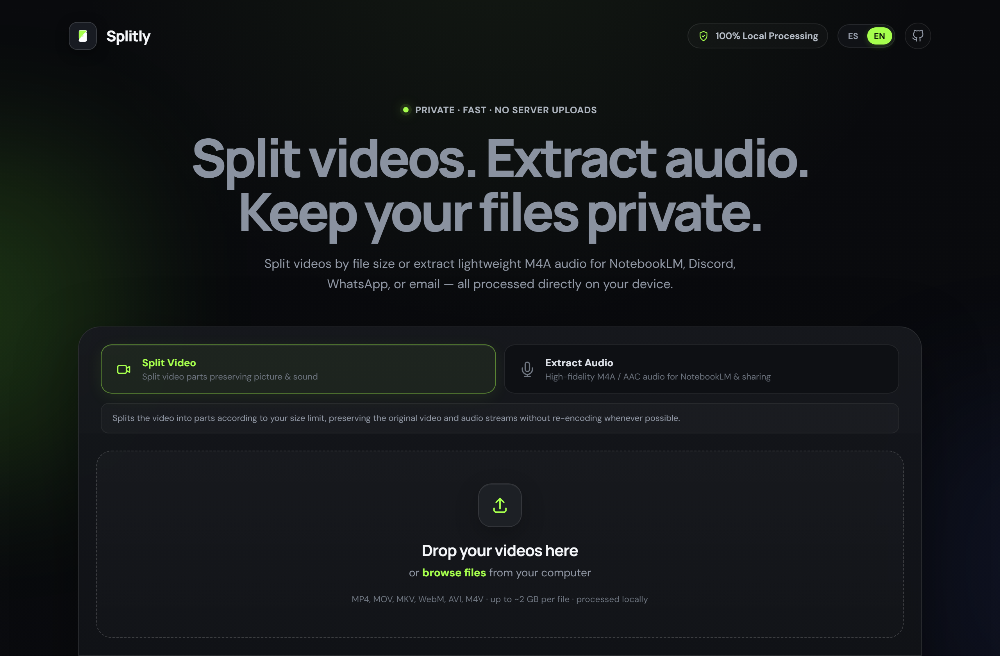
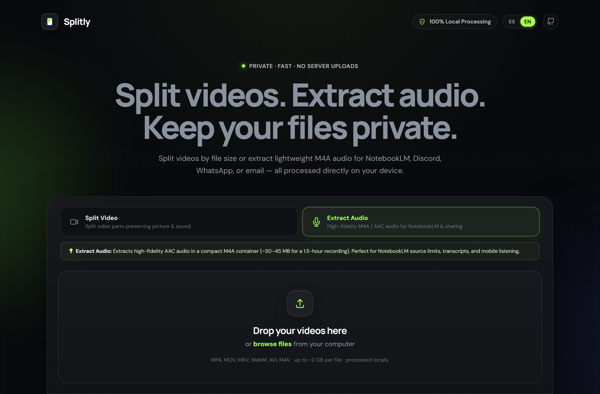
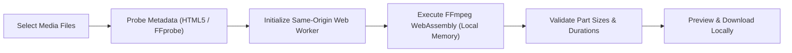

<div align="center">


<p><strong>Split videos. Extract audio. Keep your files private.</strong></p>

<p>
  <strong>English</strong> | <a href="README.es.md">Español</a>
</p>

[](LICENSE)
[](https://github.com/santi-osp/DividirVideosNotebookLM/actions/workflows/ci.yml)
[](https://santi-osp.github.io/DividirVideosNotebookLM/)
[](https://github.com/ffmpegwasm/ffmpeg.wasm)
[](src/i18n/)

<p>
  <a href="https://santi-osp.github.io/DividirVideosNotebookLM/"><strong>🌐 Launch Live Web App</strong></a> •
  <a href="docs/en/index.md"><strong>📚 Documentation</strong></a> •
  <a href="docs/en/getting-started.md"><strong>🚀 Getting Started</strong></a> •
  <a href="CONTRIBUTING.md"><strong>🤝 Contributing</strong></a>
</p>

---



</div>

---

## 💡 What is Splitly?

**Splitly** is an open-source, privacy-first multimedia utility that runs **100% inside your web browser**. It allows you to split large videos by file size or extract lightweight, crystal-clear audio files directly on your computer using **FFmpeg WebAssembly** (`@ffmpeg/ffmpeg`).

Zero video or audio data is ever transmitted to a cloud server or external backend. Your recordings stay completely private.

---

## ✨ Key Features

- 🔒 **100% Local & Private Processing**: Powered by WebAssembly. Files are demuxed, cut, and decoded entirely in your browser's local memory.
- 🎙️ **NotebookLM Audio Extraction**: Converts multi-gigabyte video recordings into compact, high-fidelity M4A (AAC 96 kbps) audio. A 1.5-hour lecture (~1 GB video) extracts into a single ~35–45 MB file in seconds, easily fitting into NotebookLM source limits without consuming valuable upload quotas.
- 🎬 **Size-Based Video Splitting**: Slice videos by targeted megabyte thresholds while preserving original streams (`-c copy`) without quality loss whenever keyframe boundaries permit.
- ⚡ **Verified Platform Presets**:
  - **NotebookLM**: 190 MB (safe margin below the official 200 MB source limit).
  - **Discord**: 25 MB (standard attachment limit for free tier).
  - **WhatsApp**: 16 MB (standard media) / 64 MB (document attachments).
  - **Email**: 25 MB (standard Gmail/Outlook attachment threshold).
  - **Custom**: Configure any size between 10 MB and 2000 MB.
- 🛑 **Reliable Cancellation**: Instantly interrupt ongoing FFmpeg processes without browser tab freezing, memory leaks, or false error alerts.
- 🌐 **100% Bilingual Interface**: Switch seamlessly between English and Spanish with immediate UI reactivity, pluralization, and zero interruption of active jobs.
- 📊 **Real-Time Progress & Previews**: Live duration decoding trackers and built-in modal playback for both video parts and extracted audio.
- 📦 **Smart Downloads**: Download individual parts or trigger paced batch downloads designed to avoid browser multi-file download blocking.

---

## 🎬 Demo in Action

<div align="center">
  
  <p><em>Also available as a lightweight <a href="docs/assets/demo/splitly-demo.mp4">HD MP4 Video</a>.</em></p>
</div>

---

## 📸 Visual Gallery

<table align="center" width="100%">
  <tr>
    <td width="50%" align="center">
      <strong>🎬 Split Video Mode</strong><br><br>
      
    </td>
    <td width="50%" align="center">
      <strong>🎙️ Extract Audio Mode (NotebookLM)</strong><br><br>
      
    </td>
  </tr>
  <tr>
    <td width="50%" align="center">
      <strong>📋 Queue & File Metadata</strong><br><br>
      
    </td>
    <td width="50%" align="center">
      <strong>✅ Completed Results & Downloads</strong><br><br>
      
    </td>
  </tr>
</table>

---

## 🔬 How it Works



1. **Ingestion**: Videos are selected via drag-and-drop or file picker.
2. **Analysis**: File duration and container characteristics are inspected with a safe 4-second timeout.
3. **Execution**: FFmpeg WebAssembly processes segments inside an isolated Web Worker.
4. **Validation**: Each generated chunk is checked for positive byte length and format validity before presentation.
5. **Retrieval**: Object URLs allow direct local download or in-browser preview without internet transfer.

---

## 🚀 Quick Start

### Use Instantly in Browser
Visit **[https://santi-osp.github.io/DividirVideosNotebookLM/](https://santi-osp.github.io/DividirVideosNotebookLM/)** on any modern desktop browser (Chrome, Edge, Firefox, Safari).

### Local Installation & Development
```bash
# 1. Clone the repository
git clone https://github.com/santi-osp/DividirVideosNotebookLM.git
cd DividirVideosNotebookLM

# 2. Install reproducible dependencies
npm ci

# 3. Start local development server
npm run dev

# 4. Build for production
npm run build

# 5. Preview production build
npm run preview
```

### Running Test Suite
```bash
# Run unit tests (Vitest)
npm run test

# Verify translation parity
npm run check:i18n

# Verify documentation parity
npm run check:docs
```

---

## ⚖️ Technical Considerations & Limitations

- **Browser Memory Architecture**: WebAssembly virtual filesystems operate within a 32-bit linear address space (~2 GB practical limit). Single-concurrency ("1 at a time") is recommended for files above 300 MB.
- **Keyframe Stream Copy**: When splitting without re-encoding (`-c copy`), split points snap to keyframes (GOP boundaries). This guarantees ultra-fast processing without generation loss, though part sizes may fluctuate by 1–3% depending on video bitrate variability.
- **First Load Network Fetch**: The WebAssembly core binaries (`~31 MB`) are downloaded from a trusted CDN on first visit and cached by your browser for subsequent use.

---

## 🛡️ Privacy & Security Guarantee

- **Zero Remote Storage**: Your videos and audio files are never uploaded to any remote server or third-party service.
- **No Telemetry**: Splitly collects zero personal analytics, zero filenames, and zero tracking cookies.
- **Security Policy**: For responsible vulnerability disclosure, please refer to [SECURITY.md](SECURITY.md).

---

## 📚 Detailed Documentation

- [User Guide](docs/en/user-guide.md)
- [Frequently Asked Questions (FAQ)](docs/en/faq.md)
- [Troubleshooting](docs/en/troubleshooting.md)
- [System Architecture](docs/en/architecture.md)
- [Development Guide](docs/en/development.md)
- [Design Decisions (ADR)](docs/development/DESIGN_DECISIONS.md)
- [Technical Audit](docs/development/AUDIT.md)

---

## 👤 Author & Maintainer

Created and maintained with ❤️ by:

**Santiago Ospina Arango**  
- GitHub: [@santi-osp](https://github.com/santi-osp)  
- Repository: [DividirVideosNotebookLM](https://github.com/santi-osp/DividirVideosNotebookLM)

---

## 📄 License & Attributions

Splitly source code is licensed under the **[MIT License](LICENSE)**.

FFmpeg is a trademark of Fabrice Bellard and the FFmpeg team. For detailed licensing notices of incorporated libraries and WebAssembly binary cores, please consult **[THIRD_PARTY_NOTICES.md](THIRD_PARTY_NOTICES.md)**.
