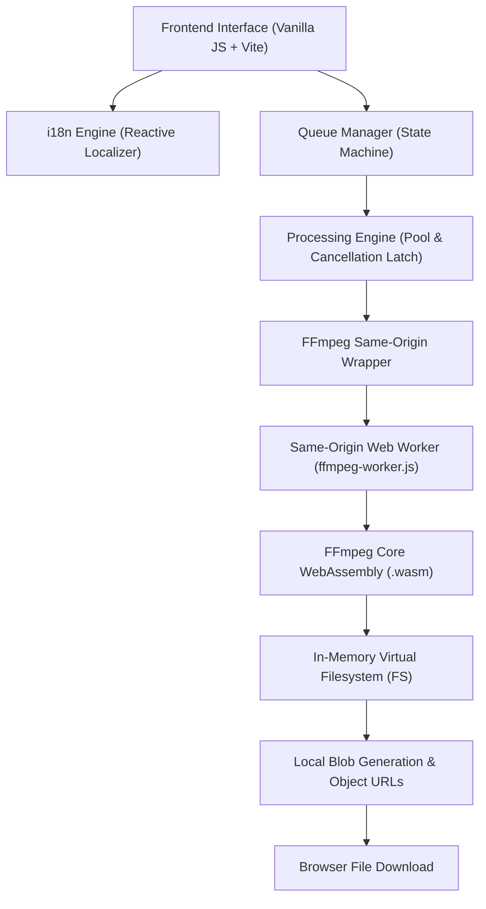
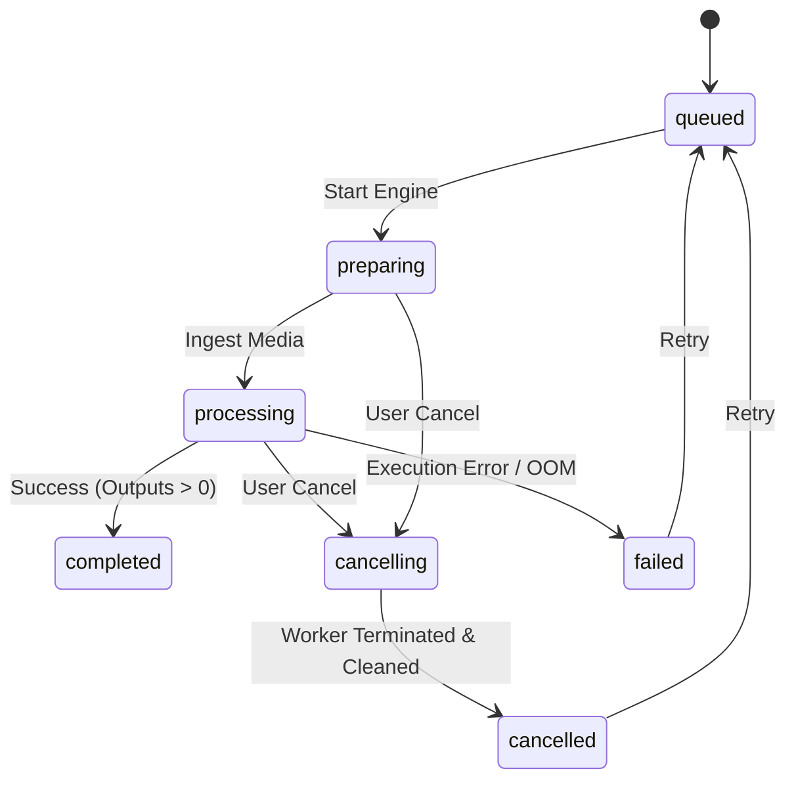
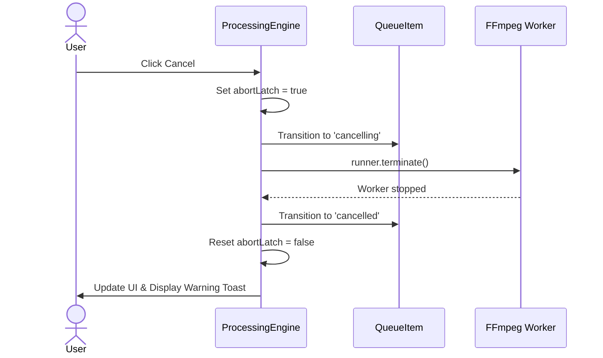

# Splitly 2.0 — System Architecture

Splitly is built on a modular, client-side WebAssembly architecture designed to deliver deterministic, memory-safe media processing without server infrastructure.

---

## 1. High-Level Architecture Diagram

---

## 2. Core Modules

### `src/i18n/` (Internationalization)
- **`index.js`**: Reactive store with pluralization parser (`one` / `other`), token replacement, language detection (localStorage -> navigator.language -> English fallback), and document title/lang synchronization.
- **`locales/en.json` & `locales/es.json`**: Translation dictionaries with 100% key parity verified by automated CI checks.

### `src/core/`
- **`media.js`**: Media inspection, size and duration formatters, HTML5 metadata probing with safe timeouts, filename sanitization, and output estimations.
- **`queue.js`**: `QueueItem` state machine and `QueueManager` handling item addition, duplicate rejection, and resource disposal (`URL.revokeObjectURL`).
- **`processing.js`**: `ProcessingEngine` concurrency pool with an Abort latch, stream copy video splitting, and AAC M4A audio extraction.

### `src/ffmpeg/`
- **`wrapper.js`**: Subclass of `@ffmpeg/ffmpeg` that supplies `classWorkerURL` pointing to the local origin.
- **`worker.js`**: Same-origin Web Worker implementing message routing (`LOAD`, `EXEC`, `WRITE_FILE`, `READ_FILE`, `DELETE_FILE`, `PROGRESS`, `LOG`) to prevent browser CORS worker rejection on GitHub Pages.

---

## 3. Queue State Machine

---

## 4. Cancellation Flow

