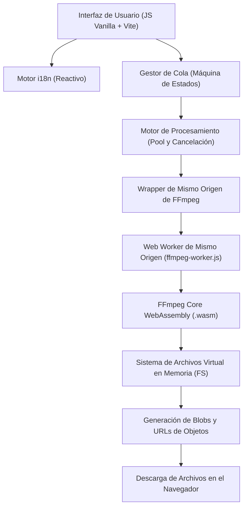
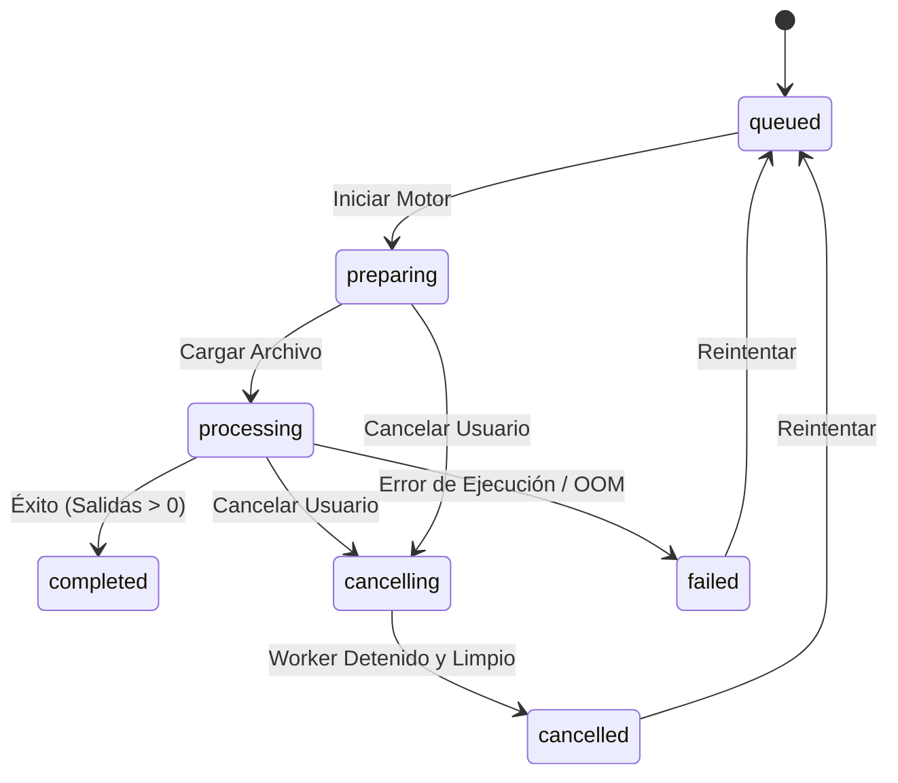
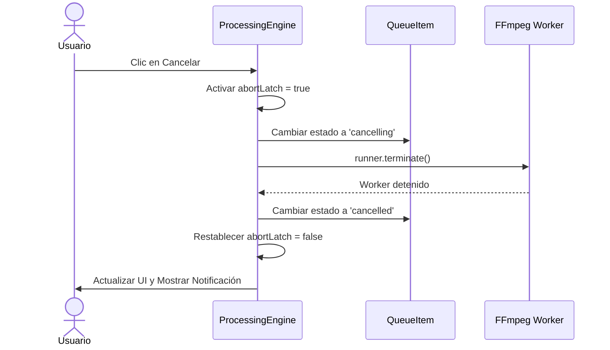

# Arquitectura del Sistema Splitly 2.0

Splitly se basa en una arquitectura modular de WebAssembly del lado del cliente, diseñada para ofrecer un procesamiento de medios seguro y determinista sin servidores externos.

---

## 1. Diagrama de Arquitectura de Alto Nivel

---

## 2. Módulos Principales

### `src/i18n/` (Internacionalización)
- **`index.js`**: Almacén reactivo con interpolación de plurales (`one` / `other`), reemplazo de variables, detección de idioma (localStorage -> navigator.language -> inglés por defecto) y sincronización del título y atributos del documento.
- **`locales/en.json` y `locales/es.json`**: Diccionarios de traducción con 100% de paridad verificada por pruebas automáticas.

### `src/core/`
- **`media.js`**: Inspección de formatos, formateo de tamaños y duraciones, sondeo de metadatos con tiempo de espera seguro, saneamiento de nombres de archivo y estimaciones de salida.
- **`queue.js`**: Máquina de estados `QueueItem` y `QueueManager` para altas de archivos, descarte de duplicados y liberación de memoria (`URL.revokeObjectURL`).
- **`processing.js`**: Motor de ejecución y concurrencia con cerrojo de cancelación, división de video por copia de stream y extracción de audio AAC en M4A.

### `src/ffmpeg/`
- **`wrapper.js`**: Subclase de `@ffmpeg/ffmpeg` que inyecta la URL del worker del mismo origen (`classWorkerURL`).
- **`worker.js`**: Web Worker de mismo origen que gestiona mensajes (`LOAD`, `EXEC`, `WRITE_FILE`, `READ_FILE`, `DELETE_FILE`, `PROGRESS`, `LOG`) para evitar bloqueos CORS en GitHub Pages.

---

## 3. Máquina de Estados de la Cola

---

## 4. Flujo de Cancelación

